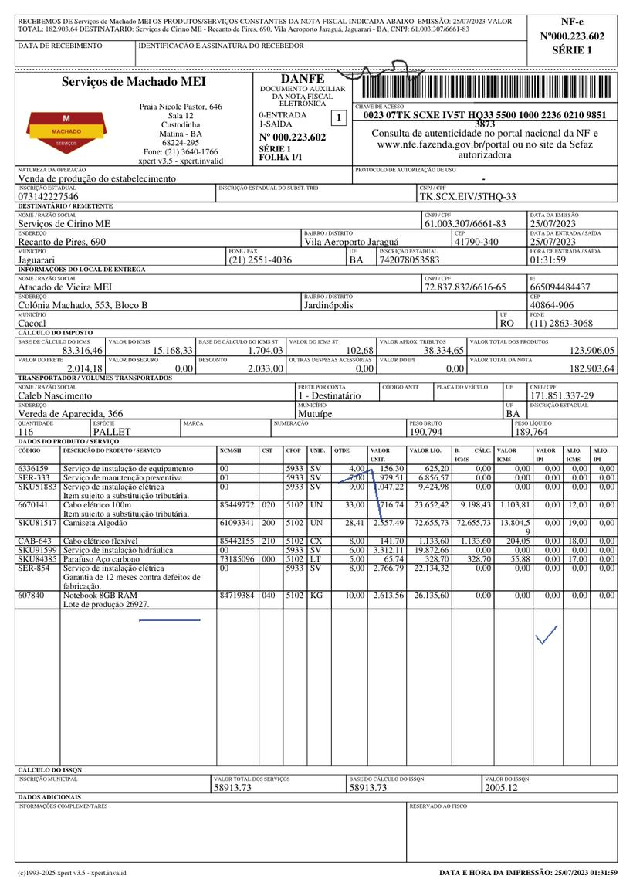

# Assinatura manuscrita

Rubrica desenhada com curvas de Bézier. No DANFE/DACTE vai no canhoto superior; em layouts sem canhoto vai ao fim do conteúdo. Preset `signature_and_scratches`.

## Como gerar

```bash
# no dataset completo (o efeito é sorteado por amostra):
python -m pipeline.cli generate --doctype danfe --count 20 --seed 42 --out dataset
# só este exemplo (determinístico):
python examples/make_effect_examples.py
```

```python
from augmentation.pipeline import augment_document
from pipeline.registry import DOCTYPES

spec = DOCTYPES["danfe"]
img_aug, label, meta = augment_document(
    image, label, field_values, seed=2026,
    artifact_preset="signature_and_scratches", scan_mode="clean_digital", angle_deg=0.0,
    context=spec.augment_context(field_values),
)
```

## Antes e depois

| antes | depois |
|---|---|
|  |  |

## O que sai

Trecho de `labels/<id>.json` (`layout.special_objects`), copiado da saída real:

```json
{
  "preset": "signature_and_scratches",
  "seed": 2026,
  "augmentation": {
    "seed": 2026,
    "angle_deg": 0.0,
    "scan_mode": "clean_digital",
    "special_objects_added": [
      "signature"
    ],
    "boxes_valid": true
  },
  "special_objects": [
    {
      "type": "signature",
      "page": 1,
      "bbox": {
        "x": 105.463,
        "y": 15.0,
        "w": 41.539,
        "h": 16.154,
        "unit": "mm"
      },
      "field_id": null
    }
  ]
}
```
