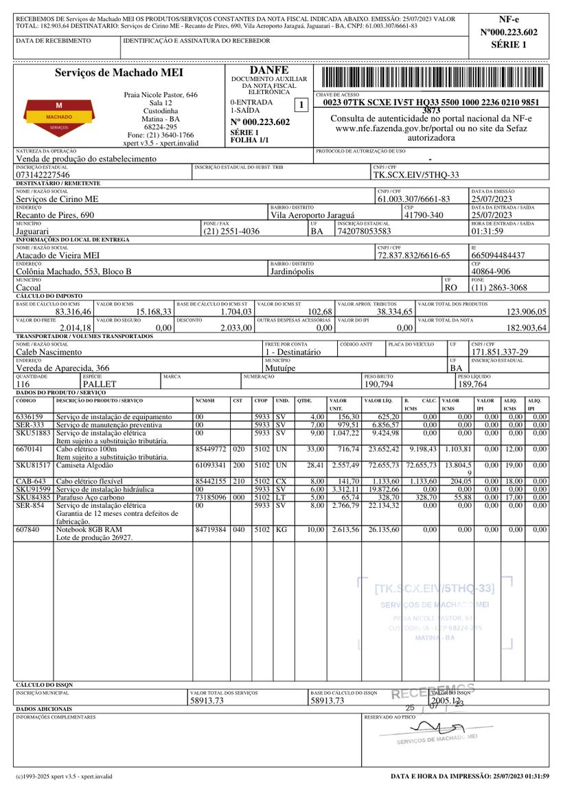

# Carimbo de CNPJ

Carimbo societário com cantoneiras (CNPJ, razão social e endereço do emitente). Preset `stamp_and_cnpj`; o `field_id` do objeto aponta para o campo do CNPJ do tipo de documento. A transcrição vem em `text`.

## Como gerar

```bash
# no dataset completo (o efeito é sorteado por amostra):
python -m pipeline.cli generate --doctype danfe --count 20 --seed 42 --out dataset
# só este exemplo (determinístico):
python examples/make_effect_examples.py
```

```python
from augmentation.pipeline import augment_document
from pipeline.registry import DOCTYPES

spec = DOCTYPES["danfe"]
img_aug, label, meta = augment_document(
    image, label, field_values, seed=2026,
    artifact_preset="stamp_and_cnpj", scan_mode="clean_digital", angle_deg=0.0,
    context=spec.augment_context(field_values),
)
```

## Antes e depois

| antes | depois |
|---|---|
|  |  |

## O que sai

Trecho de `labels/<id>.json` (`layout.special_objects`), copiado da saída real:

```json
{
  "preset": "stamp_and_cnpj",
  "seed": 2026,
  "augmentation": {
    "seed": 2026,
    "angle_deg": 0.0,
    "scan_mode": "clean_digital",
    "special_objects_added": [
      "stamp",
      "stamp"
    ],
    "boxes_valid": true
  },
  "special_objects": [
    {
      "type": "stamp",
      "subtype": "receipt_stamp",
      "page": 1,
      "bbox": {
        "x": 136.847,
        "y": 252.231,
        "w": 50.77,
        "h": 28.385,
        "unit": "mm"
      },
      "field_id": null,
      "text": [
        "RECEBEMOS",
        "25/07/23",
        "SERVIÇOS DE MACHADO MEI"
      ]
    },
    {
      "type": "stamp",
      "subtype": "cnpj_stamp",
      "page": 1,
      "bbox": {
        "x": 131.77,
        "y": 213.0,
        "w": 60.924,
        "h": 30.692,
        "unit": "mm"
      },
      "field_id": "emit_cnpj_cpf",
      "text": [
        "[TK.SCX.EIV/5THQ-33]",
        "SERVIÇOS DE MACHADO MEI",
        "PRAIA NICOLE PASTOR, 646",
        "CUSTODINHA - CEP 68224-295",
        "MATINA - BA"
      ]
    }
  ]
}
```
