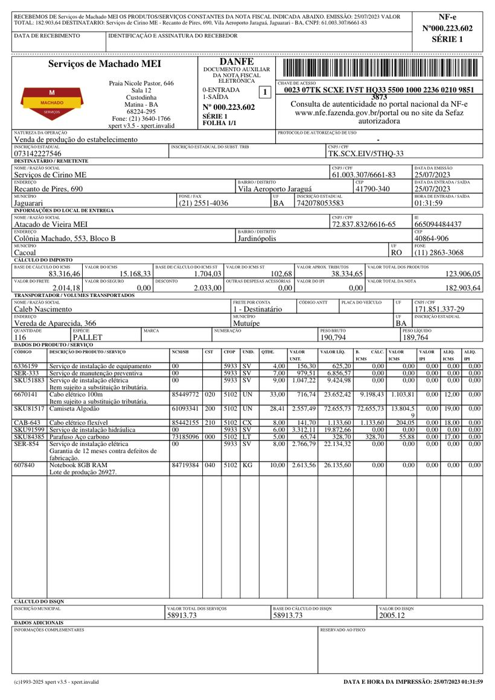
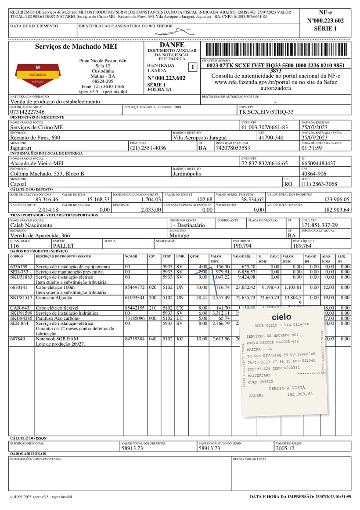

# Comprovante de cartão (POS) por cima

Via do cliente de maquininha (Getnet/Rede/Cielo/Stone) sobreposta, com empresa, data e valor do documento. Preset `pos_overlay`/`pos_and_stamp`. Não é aplicado a documentos sem valor monetário (CC-e).

## Como gerar

```bash
# no dataset completo (o efeito é sorteado por amostra):
python -m pipeline.cli generate --doctype danfe --count 20 --seed 42 --out dataset
# só este exemplo (determinístico):
python examples/make_effect_examples.py
```

```python
from augmentation.pipeline import augment_document
from pipeline.registry import DOCTYPES

spec = DOCTYPES["danfe"]
img_aug, label, meta = augment_document(
    image, label, field_values, seed=2026,
    artifact_preset="pos_overlay", scan_mode="clean_digital", angle_deg=0.0,
    context=spec.augment_context(field_values),
)
```

## Antes e depois

| antes | depois |
|---|---|
|  |  |

## O que sai

Trecho de `labels/<id>.json` (`layout.special_objects`), copiado da saída real:

```json
{
  "preset": "pos_overlay",
  "seed": 2026,
  "augmentation": {
    "seed": 2026,
    "angle_deg": 0.0,
    "scan_mode": "clean_digital",
    "special_objects_added": [
      "pos_receipt",
      "signature"
    ],
    "boxes_valid": true
  },
  "special_objects": [
    {
      "type": "pos_receipt",
      "page": 1,
      "bbox": {
        "x": 138.463,
        "y": 177.231,
        "w": 54.693,
        "h": 67.615,
        "unit": "mm"
      },
      "field_id": null,
      "text": [
        "cielo",
        "REDE CIELO - Via Cliente",
        "SERVIÇOS DE MACHADO MEI",
        "PRAIA NICOLE PASTOR 646",
        "MATINA - BA",
        "TK.SCX.EIV/5THQ-33 CV:39968745",
        "25/07/2023 17:39:35 AUT:541046",
        "DOC:921426 TERM:0700381",
        "MASTERCARD            ************9975",
        "CVAD:983322",
        "DEBITO A VISTA",
        "VALOR:         182.903,64"
      ]
    },
    {
      "type": "signature",
      "page": 1,
      "bbox": {
        "x": 85.847,
        "y": 12.0,
        "w": 30.462,
        "h": 11.769,
        "unit": "mm"
      },
      "field_id": null
    }
  ]
}
```
