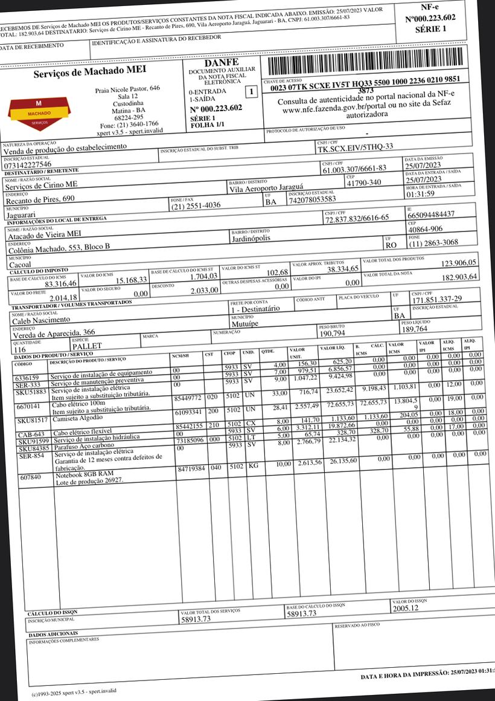

# Inclinação com reprojeção exata das caixas

A página gira de -3,8° a +3,8° (65% das amostras) e **todas as caixas** de `elements[]` e `special_objects[]` são reprojetadas: `bbox` vira o envelope e `obb_points` guarda os 4 vértices exatos.

## Como gerar

```bash
# no dataset completo (o efeito é sorteado por amostra):
python -m pipeline.cli generate --doctype danfe --count 20 --seed 42 --out dataset
# só este exemplo (determinístico):
python examples/make_effect_examples.py
```

```python
img_aug, label, meta = augment_document(
    image, label, field_values, seed=2026,
    artifact_preset="none", scan_mode="clean_digital", angle_deg=3.0,
)
```

## Antes e depois

| antes | depois |
|---|---|
|  |  |

## O que sai

O mesmo elemento antes e depois (mm); note o `obb_points`:

```json
{
  "angle_deg": 3.0,
  "antes": {
    "text": "RECEBEMOS DE Serviços de Machado MEI OS PRODUTOS/SERVIÇOS CONSTANTES DA NOTA FISCAL INDICADA ABAIXO. EMISSÃO: 25/07/2023 VALOR",
    "bbox": {
      "x": 6.001,
      "y": 5.398,
      "w": 163.968,
      "h": 3.177,
      "unit": "mm"
    }
  },
  "depois": {
    "text": "RECEBEMOS DE Serviços de Machado MEI OS PRODUTOS/SERVIÇOS CONSTANTES DA NOTA FISCAL INDICADA ABAIXO. EMISSÃO: 25/07/2023 VALOR",
    "bbox": {
      "x": 0.0,
      "y": 2.194,
      "w": 162.557,
      "h": 11.754,
      "unit": "mm",
      "obb_points": [
        [
          -1.353,
          10.775
        ],
        [
          162.391,
          2.194
        ],
        [
          162.557,
          5.367
        ],
        [
          -1.186,
          13.948
        ]
      ]
    }
  }
}
```
