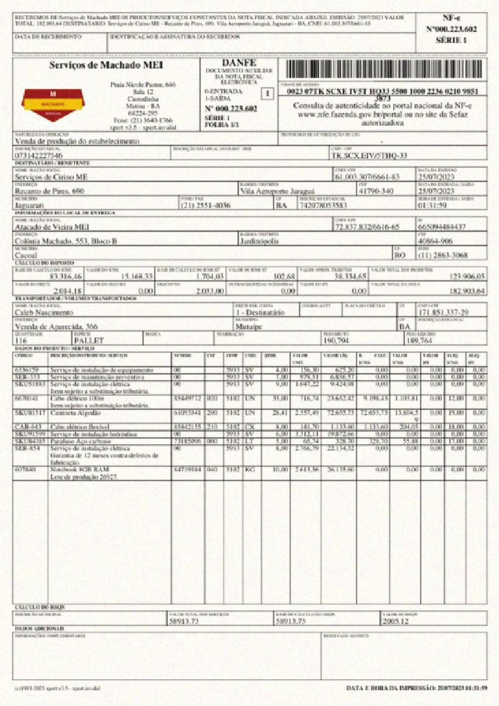
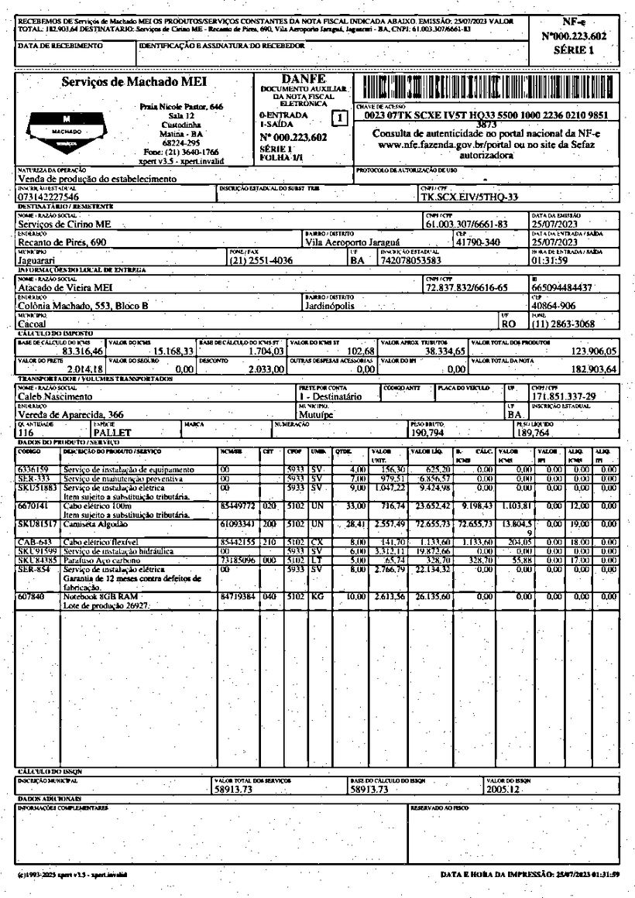

# Modos de scanner

Efeito fotométrico final: `clean_digital` (sem alteração, 20%), `color_scan` (48%) e `bw_binarized_scan` (32%). Incluem ruído, blur, brilho/contraste e compressão JPEG (`augmentation/ops.py`).

## Como gerar

```bash
python -m pipeline.cli generate --doctype danfe --count 20 --seed 42 --out dataset   # sorteado
python examples/make_effect_examples.py                                                # este exemplo
```

```python
img_aug, label, meta = augment_document(image, label, field_values, seed=2026,
                                        artifact_preset="none", scan_mode="bw_binarized_scan", angle_deg=0.0)
```

## Antes e depois

| original | clean_digital | color_scan | bw_binarized_scan |
|---|---|---|---|
|  |  |  |  |

## O que sai

O modo escolhido fica em `metadata/<id>.meta.json` → `augmentation.scan_mode`. As caixas não mudam.
