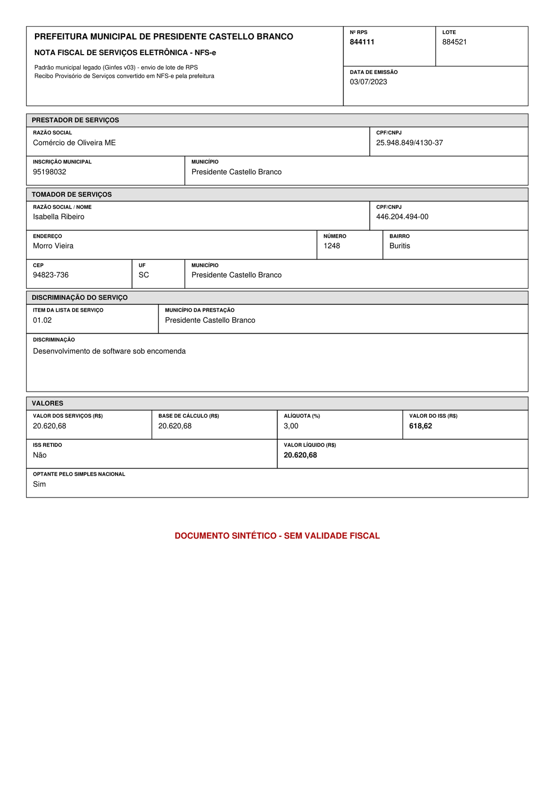
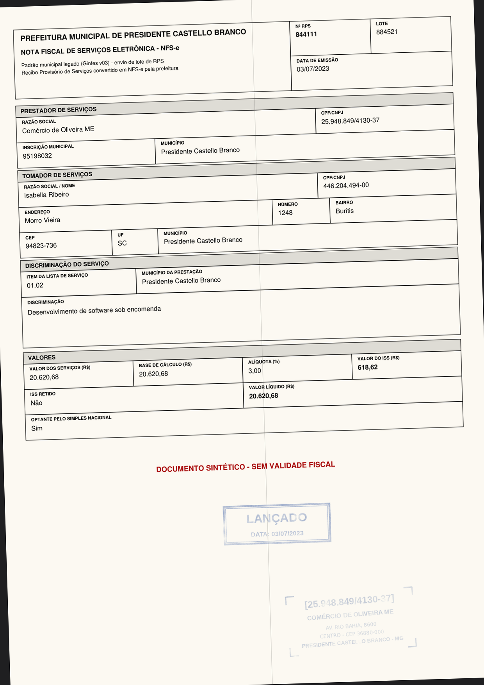

# NFS-e legada (Ginfes v03): exemplos

Lote de RPS (*Recibo Provisório de Serviços*) no padrão municipal legado, anterior ao ADN
nacional, gerado a partir do XML `EnviarLoteRpsEnvio` com os bindings da lib
`nfselib-legacy`. O PDF é um **leiaute de referência** deste repositório (não há
PDF oficial da prefeitura para esse envelope). Todo dado é sintético.

Gerado por `python examples/make_nfse_examples.py` (seed 2026, HTML/Markdown incluídos).

| Amostra | Split | `match_rate` | `text_fidelity` |
|---|---|---|---|
| `nfse_legado_train_00000000` | train | 1.00 | 1.00 |
| `nfse_legado_train_00000001` | train | 1.00 | 1.00 |
| `nfse_legado_test_00000002` | test | 1.00 | 1.00 |

## 1. PDF e imagem

A página limpa (`images/`) e a degradada (`images_aug/`) da mesma amostra:

| Limpa | Degradada |
|---|---|
|  |  |

Objetos especiais sobrepostos nesta amostra (carimbo, assinatura, POS): `stamp, stamp`,
registrados em `labels` como `special_objects` com a transcrição do texto.

## 2. XML de origem (verdade de campo)

Início de `xml/0000/nfse_legado_train_00000000.xml`, identado só para leitura (o arquivo original é uma linha):

```xml
<?xml version="1.0" ?>
<ns0:EnviarLoteRpsEnvio xmlns:ns0="http://www.ginfes.com.br/servico_enviar_lote_rps_envio_v03.xsd">
  <ns0:LoteRps Id="lote:844111">
    <ns1:NumeroLote xmlns:ns1="http://www.ginfes.com.br/tipos_v03.xsd">884521</ns1:NumeroLote>
    <ns1:Cnpj xmlns:ns1="http://www.ginfes.com.br/tipos_v03.xsd">25948849413037</ns1:Cnpj>
    <ns1:InscricaoMunicipal xmlns:ns1="http://www.ginfes.com.br/tipos_v03.xsd">95198032</ns1:InscricaoMunicipal>
    <ns1:QuantidadeRps xmlns:ns1="http://www.ginfes.com.br/tipos_v03.xsd">1</ns1:QuantidadeRps>
    <ListaRps>
      <ns1:Rps xmlns:ns1="http://www.ginfes.com.br/tipos_v03.xsd">
        <ns1:InfRps Id="rps:844111">
          <ns1:IdentificacaoRps>
            <ns1:Numero>844111</ns1:Numero>
            <ns1:Serie>1</ns1:Serie>
            <ns1:Tipo>1</ns1:Tipo>
          </ns1:IdentificacaoRps>
          <ns1:DataEmissao>2023-07-03T01:40:42</ns1:DataEmissao>
          <ns1:NaturezaOperacao>1</ns1:NaturezaOperacao>
          <ns1:OptanteSimplesNacional>1</ns1:OptanteSimplesNacional>
          <ns1:IncentivadorCultural>2</ns1:IncentivadorCultural>
          <ns1:Status>1</ns1:Status>
          <ns1:Servico>
            <ns1:Valores>
              <ns1:ValorServicos>20620.68</ns1:ValorServicos>
              <ns1:IssRetido>2</ns1:IssRetido>
              <ns1:ValorIss>618.62</ns1:ValorIss>
              <ns1:Aliquota>3.00</ns1:Aliquota>
            </ns1:Valores>
            <ns1:ItemListaServico>01.02</ns1:ItemListaServico>
```

## 3. Label: campos casados com o PDF

Cada campo é casado com o span de texto do PDF (`match_rate` = 1,0 quando todos casam).
Primeiras linhas com campo casado (`x y w h` em mm):

```
 128.3   12.7    9.5   4.2  ident_numero           844111
 163.3   11.7    9.5   4.2  ident_lote             884521
 128.8   27.6   14.2   4.3  data_emissao           03/07/2023
   9.6   53.7   31.5   4.8  prestador_razao_social Comércio de Oliveira ME
 139.5   49.9   25.4   4.7  prestador_cnpj         25.948.849/4130-37
   9.9   65.3   12.7   4.3  prestador_inscricao_municipal 95198032
```

## 4. KIE

`kie` de `labels/0000/nfse_legado_train_00000000.json`: a mesma informação, por papel, com a caixa de origem em `bbox_ref`.

```json
{
  "provider": {
    "cnpj": {
      "value": "25948849413037",
      "raw_value": "25948849413037",
      "bbox_ref": "e00014"
    },
    "tax_id_type": "cnpj",
    "name": {
      "value": "Comércio de Oliveira ME",
      "raw_value": "Comércio de Oliveira ME",
      "bbox_ref": "e00012"
    },
    "inscricao_municipal": {
      "value": "95198032",
      "raw_value": "95198032",
      "bbox_ref": "e00016"
    },
    "municipality": {
      "value": "Presidente Castello Branco",
      "raw_value": "Presidente Castello Branco",
      "bbox_ref": "e00018"
    }
  },
  "taker": {
    "document": {
      "value": "44620449400",
      "raw_value": "44620449400",
      "bbox_ref": "e00023"
    },
    "tax_id_type": "cpf",
    "name": {
      "value": "Isabella Ribeiro",
      "raw_value": "Isabella Ribeiro",
      "bbox_ref": "e00021"
    }
  },
  "document": {
    "rps_number": {
      "value": "844111",
      "raw_value": "844111",
      "bbox_ref": "e00005"
    },
    "batch_number": {
      "value": "884521",
      "raw_value": "884521",
      "bbox_ref": "e00007"
    },
    "issue_date": {
      "value": "2023-07-03T01:40:42",
      "raw_value": "2023-07-03T01:40:42",
      "bbox_ref": "e00009"
    },
    "environment": {
      "value": "homologacao",
      "raw_value": "homologacao",
      "bbox_ref": null
    }
  },
  "service": {
    "code": {
      "value": "01.02",
      "raw_value": "01.02",
      "bbox_ref": "e00038"
    },
    "description": {
      "value": "Desenvolvimento de software sob encomenda",
      "raw_value": "Desenvolvimento de software sob encomenda",
      "bbox_ref": "e00042"
    },
    "value": {
      "value": "20620.68",
      "raw_value": 20620.68,
      "bbox_ref": "e00045"
    },
    "iss_rate": {
      "value": "3.00",
      "raw_value": 3.0,
      "bbox_ref": "e00049"
    },
    "iss_value": {
      "value": "618.62",
      "raw_value": 618.62,
      "bbox_ref": "e00051"
    }
  }
}
```

## 5. Markdown visível (par de `images_aug/`)

`md_visible/0000/nfse_legado_train_00000000.md`, primeiras linhas:

```markdown
### PREFEITURA MUNICIPAL DE PRESIDENTE CASTELLO BRANCO

NOTA FISCAL DE SERVIÇOS ELETRÔNICA - NFS-e<br>Padrão municipal legado (Ginfes v03) - envio de lote de RPS<br>Recibo Provisório de Serviços convertido em NFS-e pela prefeitura

| Campo | Valor |
| --- | --- |
| Nº RPS | 844111 |
| DATA DE EMISSÃO | 03/07/2023 |
| LOTE | 884521 |

## PRESTADOR DE SERVIÇOS

| Campo | Valor |
| --- | --- |
| RAZÃO SOCIAL | Comércio de Oliveira ME |
| CPF/CNPJ | 25.948.849/4130-37 |
| INSCRIÇÃO MUNICIPAL | 95198032 |
| MUNICÍPIO | Presidente Castello Branco |

## TOMADOR DE SERVIÇOS

| Campo | Valor |
| --- | --- |
| RAZÃO SOCIAL / NOME | Isabella Ribeiro |
| CPF/CNPJ | 446.204.494-00 |
| ENDEREÇO | Morro Vieira |
| NÚMERO | 1248 |
| BAIRRO | Buritis |
| CEP | 94823-736 |
| UF | SC |
```

O HTML limpo (`html_clean/`) segue a mesma ordem de blocos do PDF, e `html_visible/` marca os
campos cobertos por carimbo/POS como `[ilegível]` (oclusão aplicada: 0 nós nesta amostra).

## 6. Como gerar

```bash
# 3 amostras com HTML/Markdown
python examples/make_nfse_examples.py

# lote completo: a seed de cada amostra deriva de (seed, tipo, split, índice)
python -m pipeline.cli generate --doctype nfse_legado --count 1000 --workers 8 --html --out dataset
```

Ver também [`README.md`](../README.md#8-exemplos-práticos) (uso em Python, ponto a ponto).
