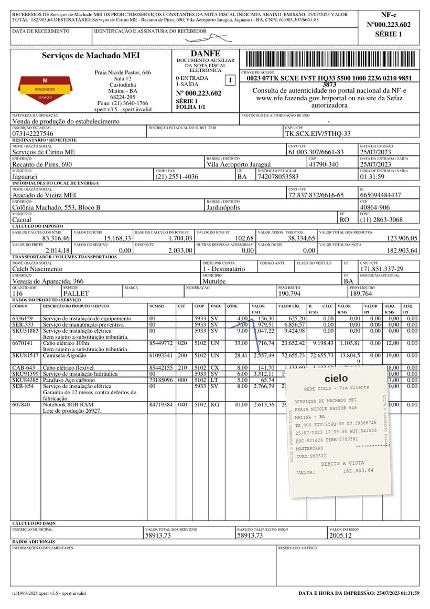

# Oclusão no HTML/Markdown (`html_visible`, `md_visible`)

Carimbo, assinatura e comprovante POS são sobrepostos depois do render, então o HTML do documento (`html_clean`) não os conhece. O `html_visible` descreve **o que a imagem degradada mostra**: cada objeto vira um `` **vazio** (só a sinalização de que há uma imagem ali), inserido depois do bloco do documento que está acima dele, e campos cobertos em ≥ 50% viram `[ilegível]`. O tipo do objeto e a transcrição ficam em `labels/` (`special_objects`).

## Como gerar

```bash
python -m pipeline.cli generate --doctype danfe --count 20 --seed 42 --html --out dataset
```

```python
from htmlgen.occlusion import apply_degradation
from htmlgen.convert import to_clean_html, to_markdown

vis_full, relatorio = apply_degradation(html_full, label)   # label já com special_objects
html_visible = to_clean_html(vis_full)
md_visible = to_markdown(vis_full, "table")
```

## Antes e depois

| imagem limpa ↔ `html_clean` | imagem degradada ↔ `html_visible` |
|---|---|
|  |  |

## O que sai

Relatório (`meta.html.occlusion`):

```json
{
  "artifacts": [
    "pos_receipt",
    "signature"
  ],
  "occluded_nodes": 11
}
```

Campos cobertos viram `[ilegível]` (em `html_visible`):

```html
          <td>CX</td>
          <td>8,00</td>
          <td>141,70</td>
          <td>[ilegível]</td>
          <td>[ilegível]</td>
          <td>[ilegível]</td>
          <td>0,00</td>
          <td>[ilegível]</td>
          <td>0,00</td>
```

O comprovante, sinalizado (`html_visible`):

```html
    <p>Nº000.223.602</p>
    <p>SÉRIE 1</p>
  </section>
  
  <header>
    <h1>Serviços de Machado MEI</h1>
```

No `md_visible` a imagem aparece como ``:

```markdown


| CAB-643 | Cabo elétrico flexível | 85442155 | 210 | 5102 | CX | 8,00 | 141,70 | [ilegível] | [ilegível] | [ilegível] | 0,00 | [ilegível] | 0,00 |
| SKU91599 | Serviço de instalação hidráulica | 00 |  | 5933 | SV | 6,00 | 3.312,11 | [ilegível] | 0,00 | 0,00 | 0,00 | 0,00 | 0,00 |
| SKU84385 | Parafuso Aço carbono | 73185096 | 000 | 5102 | LT | 5,00 | 65,74 | [ilegível] | [ilegível] | [ilegível] | 0,00 | [ilegível] | 0,00 |
| SER-854 | Serviço de instalação elétrica Garantia de
```

Arquivos completos: [`html_clean`](effects/oclusao_html/html_clean.html), [`html_visible`](effects/oclusao_html/html_visible.html), [`md_visible`](effects/oclusao_html/md_visible.md).
