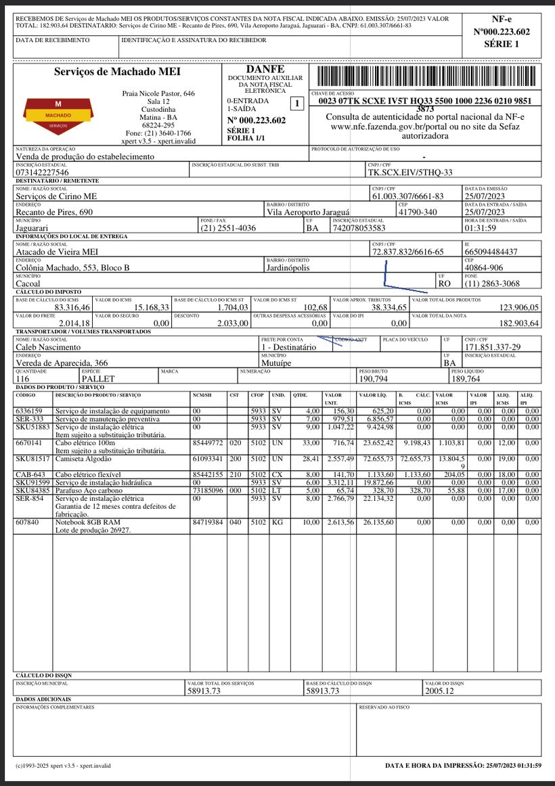
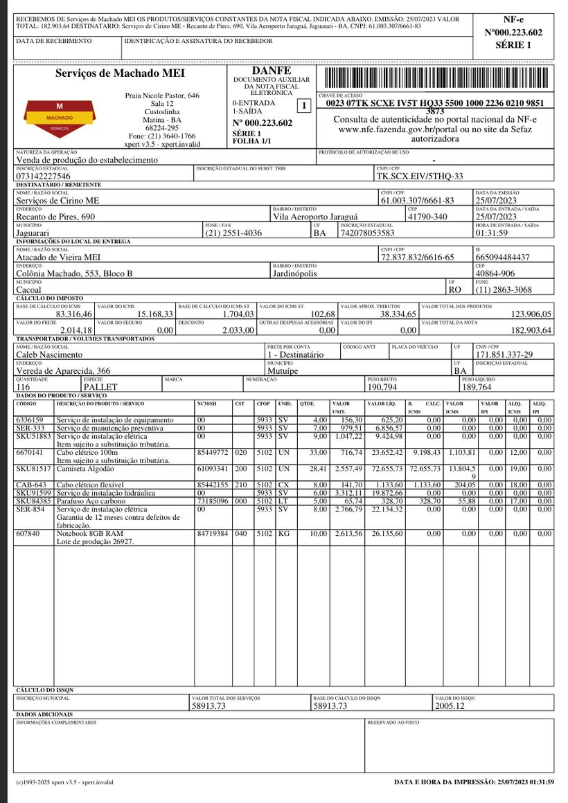
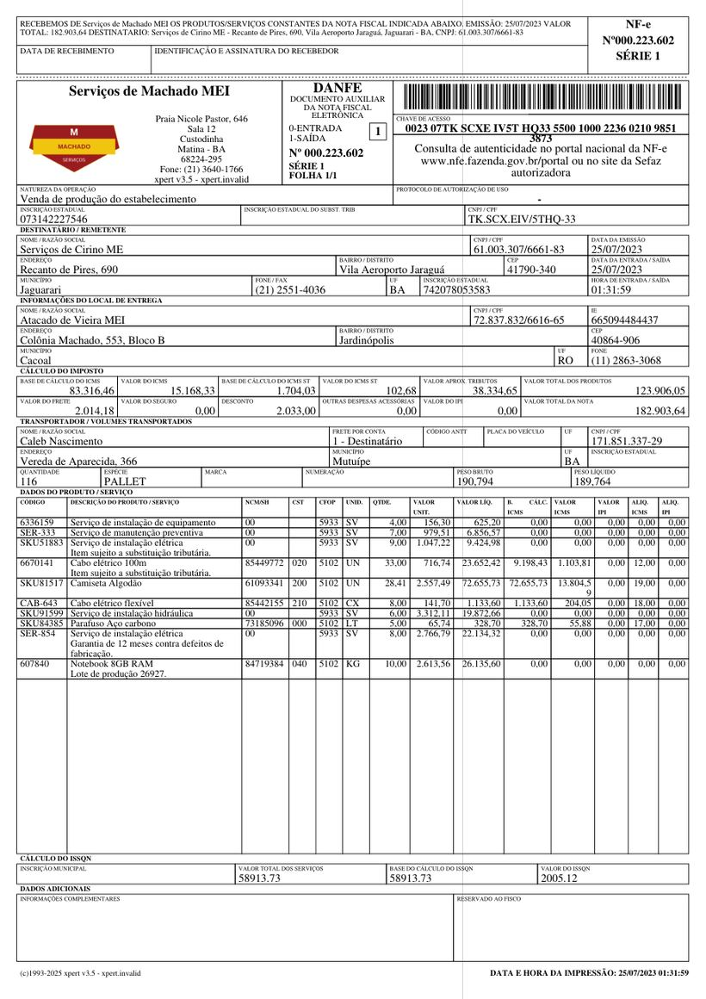

# Riscos de caneta, dobra e bordas de scanner

Riscos de caneta, faixas de scanner, dobra de papel e bordas escuras (`apply_scratches_and_scan_borders`). Cada parte é opcional e sorteada; vem junto dos presets com artefatos.

## Como gerar

```bash
# no dataset completo (o efeito é sorteado por amostra):
python -m pipeline.cli generate --doctype danfe --count 20 --seed 42 --out dataset
# só este exemplo (determinístico):
python examples/make_effect_examples.py
```

```python
import random
from augmentation.stamps import apply_scratches_and_scan_borders

out = apply_scratches_and_scan_borders(
    image, random.Random(2026),
    add_pen_scratches=True, add_scan_borders=True, add_fold_or_streak=True,
)
```

## Antes e depois

| antes | depois |
|---|---|
|  |  |

Cada parte isolada:

| só riscos | só bordas | só dobra |
|---|---|---|
|  |  |  |

## O que sai

Só altera pixels (não cria `special_objects` nem muda as caixas).
