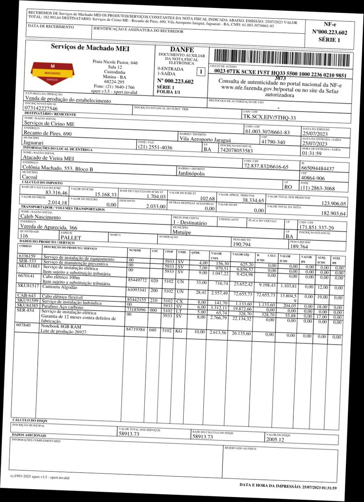

# Variante geométrica (`images_geo/`)

Distorção afim extra (Albumentations `Affine`) gravada em `images_geo/<id>.png`. **As caixas dos labels não valem para esta imagem** (`boxes_valid: false`): ela serve para treinar robustez, não para detecção.

## Como gerar

```bash
# no dataset completo (o efeito é sorteado por amostra):
python -m pipeline.cli generate --doctype danfe --count 20 --seed 42 --out dataset
# só este exemplo (determinístico):
python examples/make_effect_examples.py
```

```python
from augmentation.pipeline import augment_geometric_variant

img_geo, meta = augment_geometric_variant(image, seed=2026)
```

## Antes e depois

| antes | depois |
|---|---|
|  |  |

## O que sai

```json
{
  "seed": 2026,
  "ops": "geometric",
  "boxes_valid": false
}
```
